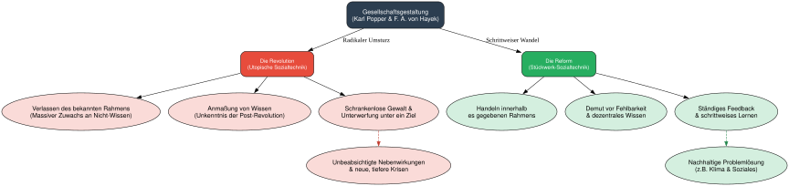

# Zeit, Zukunft und Unsicherheit

-   Niemand hat je die Zukunft gesehen

-   aber alle erwarten, dass es sie gibt\
    $\rightarrow$ Sie rechnen damit, heute nach Hause zu kommen, oder?

## Begriff

-   Zukunft bezeichnet noch kommende zeitliche Perioden

-   Zeit ordnet Perioden in eine Reihenfolge

-   Einzelne Perioden hängen zusammen

-   Zukunft ist aber nicht völlig determiniert

## Vergangenheit, Gegenwart und Zukunft

-   Die Vergangenheit war einmal eine/die Zukunft

-   Blick in die Vergangenheit offenbart, wie Vergangenheit, Gegenwart und Zukunft zusammenhingen

-   Arbeitshypothese: Vielleicht besteht dieser Zusammenhang fort

```{r}
#| message: false
#| warning: false
#| include: false

# knitr::opts_chunk$set(dev = 'svg') # set output device to svg


library(tidyverse) 
library(eurostat)

mydata <- get_eurostat("nama_10_gdp",
                       type = "label",
                       time_format = "num",
                       select_time="Y",
                       cache = T
) %>%
  filter(na_item =="Gross domestic product at market prices",
         unit =="Chain linked volumes (2015), million euro",
         geo==c("Germany")
         )


model1 <- lm(values ~ TIME_PERIOD + I(TIME_PERIOD^2), data=mydata)

options(scipen=999)
#summary(model1)

temp_var <- predict(model1, interval="prediction")

mydata <- cbind(mydata, temp_var)
```

```{r echo=T, warning=F, message=F, cache=F}

library(tidyverse)

mydata_short <- mydata %>% select(TIME_PERIOD, values, fit, lwr, upr)

df <- data.frame(seq(2022, 2060, 1), NA, NA, NA, NA)
names(df) <- c("TIME_PERIOD", "values", "fit", "lwr", "upr" )

mydata_extended <- rbind(mydata_short, df)

options(scipen = 999)

p <- mydata_extended %>%
    ggplot(aes(TIME_PERIOD, values))+
   # xlim(1990, 2021)+
    geom_point()+
   # geom_line() +
    geom_smooth(method = 'lm', 
                formula = y ~ x+ I(x^2),
                fullrange=T,
    #            color="red"
                )+
   # geom_smooth(method = 'lm',
   #             fullrange=T
  #  )+
  geom_vline(xintercept= max(mydata$TIME_PERIOD),linetype = "dashed" )+
geom_line(aes(y=lwr), color = "red", linetype = "dashed")+
geom_line(aes(y=upr), color = "red", linetype = "dashed")+
    annotate("text", x=2000, y=4500000, label="Vergangenheit", color="grey30")+
  annotate("text", x=2035, y=4500000, label="Zukunft", color="grey30")+
  theme_classic() +
    scale_x_continuous(breaks = 2024,
                     labels = "Gegenwart") +
      scale_y_continuous(#expand = c(0, 0), 
                     breaks = NULL) +
  theme(axis.line = element_line(arrow = arrow(type='closed', length = unit(5,'pt'))))+
  labs(#fill="Index",
       title="Prognoseunsicherheit",
       x="Zeit", y='Werte',
       caption = paste('Illustration: Jan S. Voßwinkel, 2024'))


p2 <- mydata_extended %>%
    ggplot(aes(TIME_PERIOD, values))+
   # xlim(1990, 2021)+
    geom_point()+
   # geom_line() +
    geom_smooth(method = 'lm', 
                formula = y ~ x+ I(x^2),
                fullrange=F,
    #            color="red"
                )+
   # geom_smooth(method = 'lm',
   #             fullrange=T
  #  )+
  geom_vline(xintercept=max(mydata$TIME_PERIOD),linetype = "dashed" )+
geom_line(aes(y=lwr), color = "red", linetype = "dashed")+
geom_line(aes(y=upr), color = "red", linetype = "dashed")+
    annotate("text", x=2000, y=4500000, label="Vergangenheit", color="grey30")+
  annotate("text", x=2035, y=4500000, label="Zukunft", color="grey30")+
  theme_classic() +
    scale_x_continuous(breaks = 2024,
                     labels = "Gegenwart") +
      scale_y_continuous(#expand = c(0, 0), 
                     breaks = NULL) +
  theme(axis.line = element_line(arrow = arrow(type='closed', length = unit(5,'pt'))))+
  labs(#fill="Index",
       title="Prognoseunsicherheit",
       #subtitle= "Anteil am BIP, 2020",
       x="Zeit", y='Werte',
       caption = 'Illustration: Jan S. Voßwinkel')

```

```{r echo=T, warning=F, message=F, cache=F}

p +
  coord_cartesian(xlim = c(1990, 2024), ylim=c(min(mydata$values), max(mydata$values)))

```

-   Beobachtungen der Vergangenheit
-   Regelmäßiger Prozess
-   Erkennbarer Trend

```{r echo=T, warning=F, message=F, cache=F}

p2

```

-   Wie geht es weiter?

```{r echo=T, warning=F, message=F, cache=F}

p
```


```{r}
#| message: false
#| warning: false
#| fig-cap: "Prognoseunsicherheit"

library(dplyr)
library(tidyr)
library(purrr)
library(forecast)
library(ggplot2)


countries_of_interest <- c("Germany", "Italy", "Ireland",  "Greece", "France", "Poland", "China")

# Fetch the data
df <- read.csv("https://ourworldindata.org/grapher/gdp-per-capita-worldbank.csv?v=1&csvType=full&useColumnShortNames=true") %>%
  select(!c(code, owid_region)) %>%
  filter(entity %in% countries_of_interest)  %>%
  mutate(ny_gdp_pcap_pp_kd= log(ny_gdp_pcap_pp_kd))

# Fetch the metadata
# metadata <- fromJSON("https://ourworldindata.org/grapher/gdp-per-capita-worldbank.metadata.json?v=1&csvType=full&useColumnShortNames=true")

# head(df)

# Prognosen erstellen

# Prognosezeitraum

h <- 10

dat_forecast <- df %>%
  group_by(entity) %>%
  nest() %>%
  mutate(
    # Zeitreihen-Objekte erstellen
    ts_obj = map(data, ~ ts(.x$ny_gdp_pcap_pp_kd, start = min(.x$year), frequency = 1)),
    # ARIMA-Modelle anpassen
    modell = map(ts_obj, ~ auto.arima(.x)),
    # Prognosen erstellen (h Jahre)
    prognose = map(modell, ~ forecast(.x, h = h)),
    # Letztes Jahr der historischen Daten
    last_year = map_int(data, ~ max(.x$year)),
    # Prognose-Tibbles erstellen
    prognose_tbl = map2(prognose, last_year, ~ {
      tibble(
        year = (.y + 1):(.y + h),
        Prognose = as.numeric(.x$mean),
        Unteres95 = as.numeric(.x$lower[, 2]),
        Oberes95 = as.numeric(.x$upper[, 2])
      )
    })
  ) %>%
  select(entity, prognose_tbl) %>%
  unnest(prognose_tbl)

# Originaldaten für Plot vorbereiten
df_plot <- df %>%
  mutate(Typ = "Original") %>%
  select(entity, year, Wert = ny_gdp_pcap_pp_kd, Typ)

# Prognosedaten für Plot vorbereiten
prognose_plot <- dat_forecast %>%
  mutate(Typ = "Prognose") %>%
  rename(Wert = Prognose) %>%
  select(entity, year, Wert, Typ, Unteres95, Oberes95)

# Kombinierte Daten für ersten Plot
plot_df <- bind_rows(df_plot, prognose_plot)

# head(plot_df)

# 2. Plot: Mit Unsicherheitsintervallen
ggplot() +
  geom_line(data = df_plot, aes(x = year, y = Wert), color = "black") +
  geom_line(data = prognose_plot, aes(x = year, y = Wert), color = "blue", linetype = "dashed") +
  geom_ribbon(
    data = prognose_plot,
    aes(x = year, ymin = Unteres95, ymax = Oberes95),
    alpha = 0.2,
    fill = "blue"
  ) +
 #  scale_y_log10() +
  facet_wrap(~ entity, scales = "free_y") +
  theme_minimal() +
  labs(title = "BIP Zeitreihen und ARIMA-Prognose mit Unsicherheit",
       subtitle = "log BIP pro Kopf, kaufkraftbereinigte Dollar",
       x= "Jahr",
       caption = "Eigene Darstellung. Daten: ourworldindata.org")

# Zusätzlich: Modellzusammenfassungen anzeigen
modelle <- df %>%
  group_by(entity) %>%
  nest() %>%
  mutate(
    ts_obj = map(data, ~ ts(.x$ny_gdp_pcap_pp_kd, start = min(.x$year), frequency = 1)),
    modell = map(ts_obj, ~ auto.arima(.x))
  )
```


## Unterschiedliche Modelle zeitlicher Verläufe

### Zukunft hängt von der Gegenwart ab

-   $x_t=f(x_{t-1})+e_t$

### Zukunft hängt nur von der Zeit ab

-   $x_t=\beta_0+ f(t)+e_t$

$\rightarrow$ Ansatzpunkte zur Gestaltung der Zukunft:

-   Der funktionale Zusammenhang $f(\cdot)$

-   Die Gegenwart

-   *Nicht*: Der Störterm

### Zwischenfazit

-   Die Zukunft ist ungewiss

-   Selbst bei Fortschreibung der Gegenwart hohe Unsicherheit in fernerer Zukunft

-   Noch höhere Unsicherheit bei Strukturbrüchen

-   Zukunft hängt ab von

    -   eigenen Entscheidungen und
    -   Entscheidungen anderer

$\rightarrow$ Ökonomische Analyse sozialer Phänomene

### Teile der Zukunft sind bereits vergangen

```{r echo=T, warning=F, message=F, cache=T}
library(tidyverse)

# Funktionen definieren
  
  x <- -3:3
  
  Grenze_oben <- function(x) x
  Grenze_unten <- function(x) -x
  
  Grenze_oben1 <- function(x) -.5+x
  Grenze_unten1 <- function(x) -1.5-x
  
  z  <- seq(-1, 0, 0.01)
  z1  <- seq(-.5, .7, 0.01)
  
  # Grafik
  
  ggplot()+
    annotate("point", x=0, y=0)+
    
    annotate("segment", x=0, xend=0, y=-2.2, yend=1, linetype="dashed")+
   # stat_function(fun = Grenze_oben, xlim = c(0, 1))+
  #  stat_function(fun = Grenze_unten, xlim = c(0, 1))+
    geom_ribbon(aes(x = z, ymin = Grenze_unten(z), ymax = Grenze_oben(z)), alpha = 0.25) +
    annotate("point", x=-.5, y=-1)+
    geom_ribbon(aes(x = z1, ymin = Grenze_unten1(z1), ymax = Grenze_oben1(z1)), alpha = 0.25) +
    annotate("segment", x=0, xend = .5, y=0, yend = 0, linetype="dashed")+
    
    geom_segment(aes(x = -.5, y = -1, xend = .5, yend = 0), size=.8,
                 arrow = arrow(length = unit(0.2, "cm")))+
    annotate("segment", x=.5, xend = .5, y=-2.2, yend=1, linetype="dashed")+
    annotate("segment", x=-.5, xend = -.5, y=-2.2, yend=1, linetype="dashed")+
    scale_x_continuous(breaks = c(-.5, 0, .5),
                       labels = expression("t"[-1], "t"[0], "t"[1]))+
    scale_y_continuous(breaks = NULL)+
    theme_classic()+
    theme(panel.grid = element_blank()) +
    theme(axis.line = element_line(arrow = arrow(type='closed', length = unit(5,'pt'))))+
    labs(title="Welche Information beeinflusst die Gegenwart",
         caption="Darstellung: Jan S. Voßwinkel",
         x = "Zeit", y = "Position", 
         color="",
         fill="")

```

$\rightarrow$ Teile der Zukunft sind nicht mehr änderbar

## Prognose und Freiheit

-   Passen Vorhersehbarkeit und Willensfreiheit zusammen?

-   Individuelles Verhalten ist oft je nach Situation gut vorhersehbar (z.B. Straßenverkehr)

-   Soziale Phänomene hängen oft nicht stark von individuellem Verhalten ab sondern vom Zusammenspiel vieler Entscheidungen (manchmal geben aber auch Individuen den Ausschlag)

## Zur Planbarkeit sozialer Phänomene

-   Die Zukunft ist (in Teilen) gestaltbar

-   Gestaltbarkeit aber nicht beliebig: Gesellschaftliche Prozesse lassen sich nicht beliebig formen

## Revolution vs Reform

```{python}
#| output: false

import graphviz
# from IPython.display import display, SVG

# Initialisierung des gerichteten Graphen
dot = graphviz.Digraph(
    comment='Revolution vs. Reform (Popper & Hayek)', format='svg'
)
dot.attr(rankdir='TB', size='12,12', fontname='Helvetica')
dot.attr('node', fontname='Helvetica', style='filled', margin='0.2')

# Zentrales Thema (Root)
dot.node(
    'Root',
    'Gesellschaftsgestaltung\n(Karl Popper & F. A. von Hayek)',
    fillcolor='#2c3e50',
    fontcolor='white',
    shape='box',
    fontsize='14',
    style='filled,rounded',
)

# Hauptäste: Revolution vs. Reform
dot.node(
    'Rev',
    'Die Revolution\n(Utopische Sozialtechnik)',
    fillcolor='#e74c3c',
    fontcolor='white',
    shape='box',
    fontsize='12',
    style='filled,rounded',
)
dot.node(
    'Ref',
    'Die Reform\n(Stückwerk-Sozialtechnik)',
    fillcolor='#27ae60',
    fontcolor='white',
    shape='box',
    fontsize='12',
    style='filled,rounded',
)

dot.edge('Root', 'Rev', label='Radikaler Umsturz')
dot.edge('Root', 'Ref', label='Schrittweiser Wandel')

# Ast 1: Revolution (Gefahren & Dynamiken)
dot.node(
    'Rev1',
    'Verlassen des bekannten Rahmens\n(Massiver Zuwachs an Nicht-Wissen)',
    fillcolor='#fadbd8',
    shape='ellipse',
)
dot.node(
    'Rev2',
    'Anmaßung von Wissen\n(Unkenntnis der Post-Revolution)',
    fillcolor='#fadbd8',
    shape='ellipse',
)
dot.node(
    'Rev3',
    'Schrankenlose Gewalt &\nUnterwerfung unter ein Ziel',
    fillcolor='#fadbd8',
    shape='ellipse',
)
dot.node(
    'Rev4',
    'Unbeabsichtigte Nebenwirkungen\n& neue, tiefere Krisen',
    fillcolor='#fadbd8',
    shape='ellipse',
)

dot.edge('Rev', 'Rev1')
dot.edge('Rev', 'Rev2')
dot.edge('Rev', 'Rev3')
dot.edge('Rev3', 'Rev4', color='#c0392b', style='dashed')

# Ast 2: Reform (Stabilität & Lernfähigkeit)
dot.node(
    'Ref1',
    'Handeln innerhalb\nes gegebenen Rahmens',
    fillcolor='#d4efdf',
    shape='ellipse',
)
dot.node(
    'Ref2',
    'Demut vor Fehlbarkeit\n& dezentrales Wissen',
    fillcolor='#d4efdf',
    shape='ellipse',
)
dot.node(
    'Ref3',
    'Ständiges Feedback\n& schrittweises Lernen',
    fillcolor='#d4efdf',
    shape='ellipse',
)
dot.node(
    'Ref4',
    'Nachhaltige Problemlösung\n(z.B. Klima & Soziales)',
    fillcolor='#d4efdf',
    shape='ellipse',
)

dot.edge('Ref', 'Ref1')
dot.edge('Ref', 'Ref2')
dot.edge('Ref', 'Ref3')
dot.edge('Ref3', 'Ref4', color='#1e8449', style='dashed')

# 1. Als SVG-Datei speichern (erzeugt 'popper_hayek_vergleich.svg')
output_filename = 'popper_hayek_vergleich'
dot.render(output_filename, cleanup=True)
print(f'SVG erfolgreich gespeichert unter: {output_filename}.svg')

# 2. Direkt in IPython / Jupyter Notebook anzeigen
# display(SVG(filename=f'{output_filename}.svg'))
```



-   Revolution bedeutet das Verlassen des Rahmens, für den man (einigermaßen) verstanden hat.

-   Reformen bedeuten, dass man innerhalb eines gegebenen Rahmens Veränderungen vornimmt.

